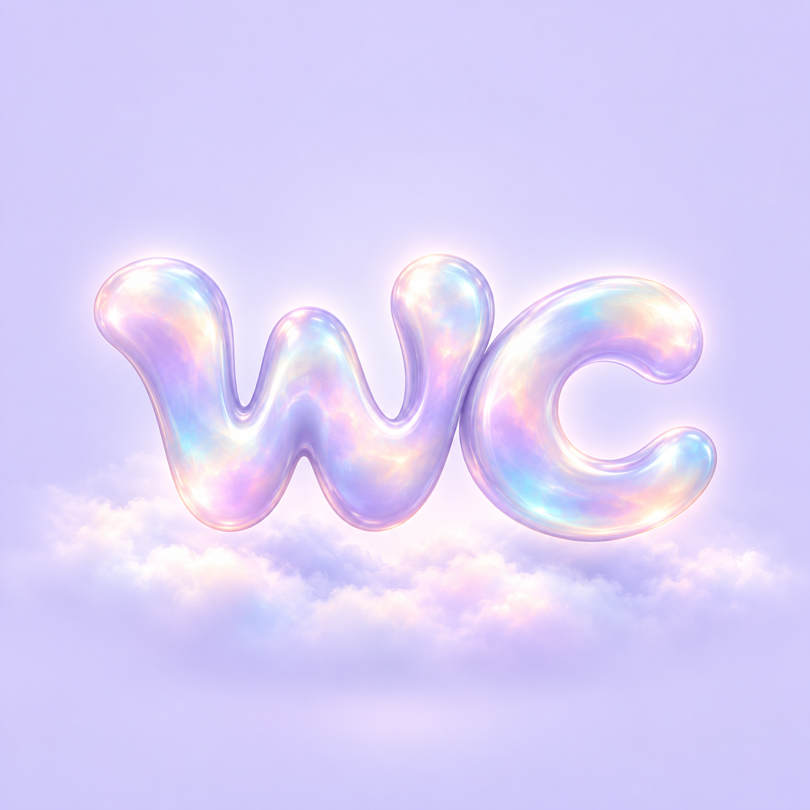
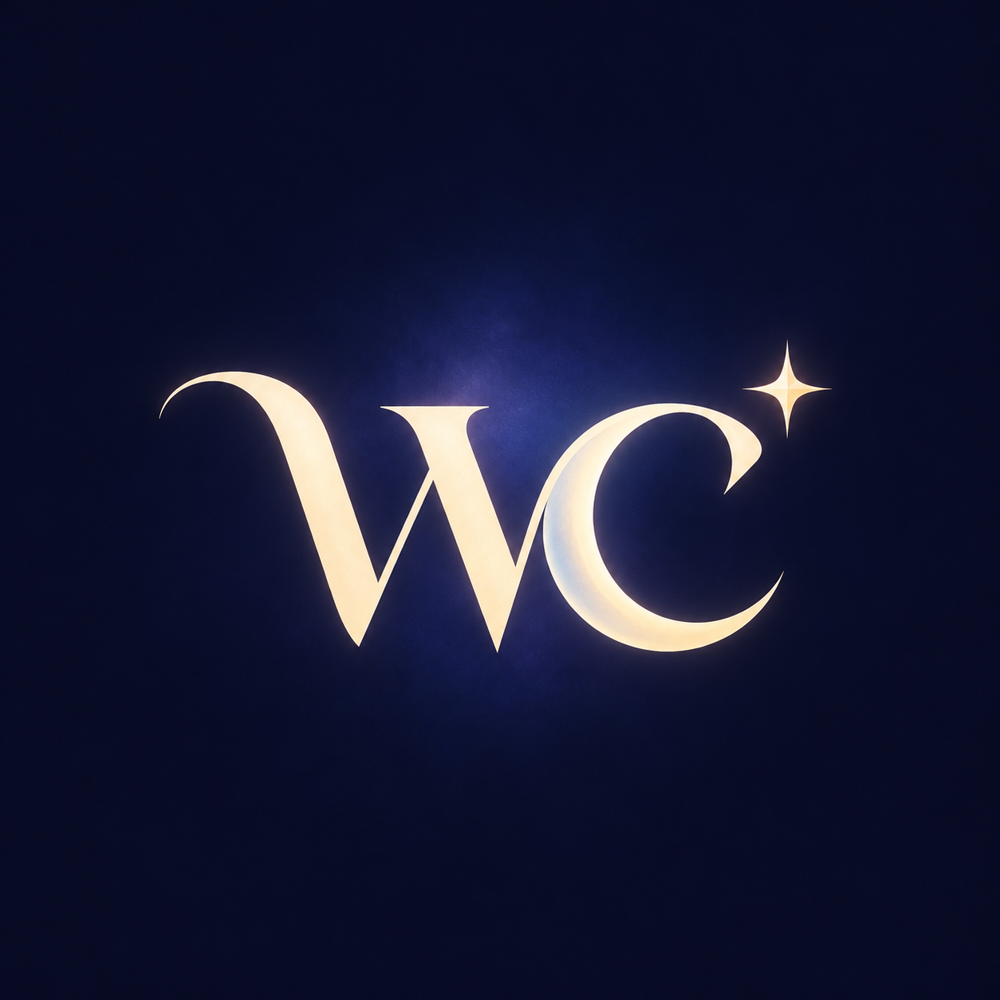
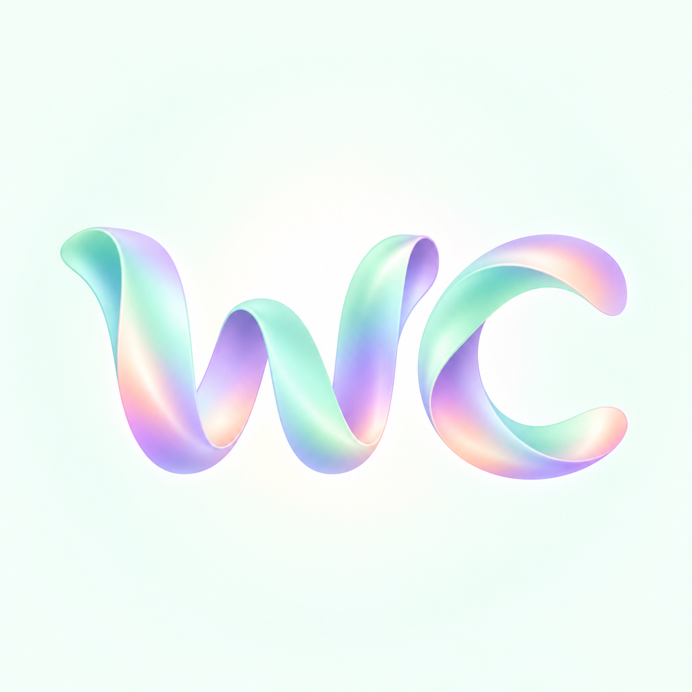

# wc logo concepts

Three dreamy wordmark directions generated with the built-in image generation tool. These are concept images with backgrounds; a primary logo has not yet been selected.

| Option | Direction | Character |
| --- | --- | --- |
| 1 | Pearl Cloud | Pearlescent rounded lettering, lavender mist, playful and ethereal |
| 2 | Midnight Crescent | Ivory serif lettering, crescent forms and a star, elegant and celestial |
| 3 | Aurora Ribbon | Flowing mint and lilac satin lettering, airy and contemporary |

## 1 — Pearl Cloud

## 2 — Midnight Crescent

## 3 — Aurora Ribbon

## Next step

Choose a direction before producing transparent, monochrome and small-size variants for consistent use across the project and future website. The current project contains no website implementation.

## Generation prompts

### Option 1

Use case: logo-brand. Create one polished logo concept for project wc-prime. Exact and only text: "wc", lowercase w then lowercase c, clearly legible. A dreamy custom rounded wordmark sculpted from luminous pearlescent opal, soft lavender, blush and icy blue iridescence. The w and c have cohesive thick elegant rounded strokes, close together but distinct readable letters. Float the wordmark above a tiny bed of ethereal cloud mist on a clean pale lavender background. Quiet luxurious dreamlike feeling, soft shadows and subtle halo. Centered large wordmark, generous clear margins, square image. Keep details restrained and silhouette suitable as a website identity. No extra text, no mockup objects, no watermark.

### Option 2

Use case: logo-brand. Create one polished logo concept for project wc-prime. Exact and only text: "wc", lowercase w then lowercase c, clearly legible. Dreamy celestial wordmark, graceful custom soft serif lettering in warm ivory on deep midnight indigo. The c gently evokes a crescent moon without losing c readability; one very small four pointed star accents the upper right of the wordmark. Elegant restrained flat graphic design, refined sweeping w, balanced beautiful typography, subtle atmospheric periwinkle glow behind the mark, almost solid midnight background. Square image, centered large logo with generous clear margins. Premium identity for a website, strong readable silhouette. No extra words, no watermark, no scene or mockup.

### Option 3

Use case: logo-brand. Create one polished logo concept for project wc-prime. Exact and only text: "wc", lowercase w then lowercase c, clearly legible. Dreamy flowing ribbon wordmark made of broad smooth satin ribbons, minimalist typographic structure, mint and lilac aurora gradient with a touch of peach. Letters w and c retain distinct readable open counters, a fluid w followed by open c, cohesive stroke weight. Airy almost white mint background with extremely subtle diffused glow, precise clean edges, refined contemporary identity, playful but premium. No clouds or stars. Square image, centered large wordmark with generous clear margins. No extra words, no watermark, no mockup.
